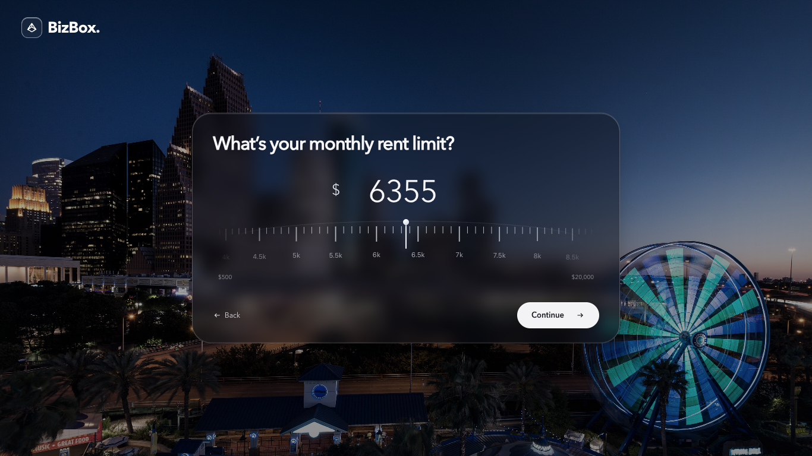
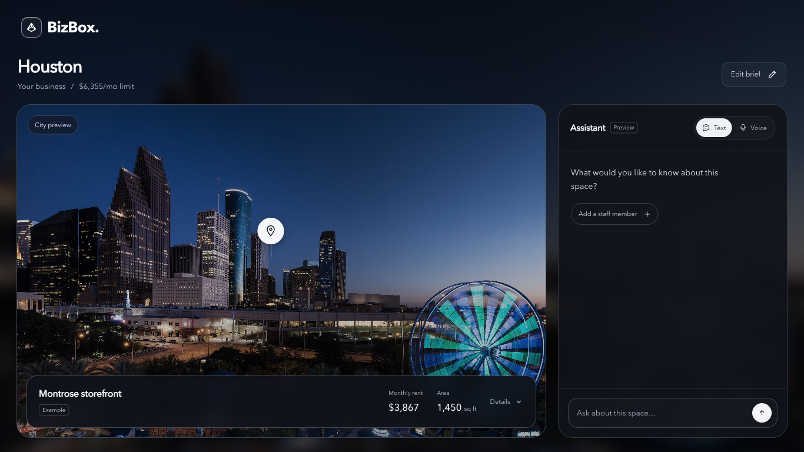
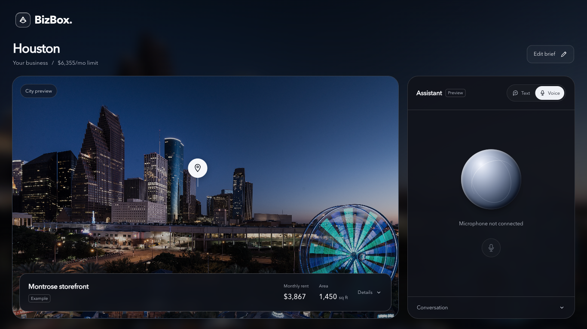

# BizBox onboarding design reference

Editable, standalone UI prototype for **HAC-112**. Akshar requested this draft PR so
others can adjust the design and handle production integration. It does not change
any Next.js routes, shared contracts, services, dependencies, or application tokens.



The final screen now separates the city/selected space from the assistant, with a
shared Text / Voice toggle. Voice is a visual preview with no connected microphone.




## Run and adjust

From the repository root:

```sh
python3 -m http.server 4176 --bind 127.0.0.1 --directory docs/design-prototypes/bizbox-onboarding
```

Open [the first question](http://127.0.0.1:4176/?step=category&theme=night) or
[the rent ruler](http://127.0.0.1:4176/?step=rent&theme=night), or
[the final screen](http://127.0.0.1:4176/?step=workspace&theme=night). Use another port if
4176 is occupied. Any static HTTP server works; there is no install/build step for
this reference. Python is an optional local preview command, not an app service.

| File                                          | Adjust here                                                                              |
| --------------------------------------------- | ---------------------------------------------------------------------------------------- |
| `app.js`                                      | Question order/copy, options, validation, session state, review, scripted workspace/chat |
| `workspace.css`                               | Final screen layout, selected-space dock, Text / Voice tabs, static voice preview        |
| `simple.css`                                  | Final static glass, radius, blur and motion overrides                                    |
| `pool.css`                                    | Current compact form layout and ruler appearance; the name is historical                 |
| `tactile.js`                                  | Direct ruler dragging, bounded release momentum, detents and keyboard controls           |
| `simple-motion.js`                            | 120 ms fade on new question content; reduced motion swaps immediately                    |
| `index.html`                                  | Stylesheet order and standalone page shell                                               |
| `photos/credits.html`, `photos/manifest.json` | Photo attribution, licenses and checksums                                                |

The remaining CSS layers preserve the reviewed prototype's layout and appearance.
Their filenames reflect earlier iterations; **the old pool, spring and distortion
JavaScript is not included or loaded**. Keep `simple.css` after the onboarding layers; `workspace.css` follows it for the final screen. Consolidating the
styles is a possible follow-up, not required to view or edit this handoff.

## Current direction

- Centered dark translucent glass over real Los Angeles/Houston photos, neutral
  white actions, readable controls, no green onboarding accent.
- One question per screen. Only question, answer and navigation; no step count,
  progress bar, helper paragraphs, location caption or consumer-facing credits.
- **Stable glass:** constant fill `rgba(16,19,27,.44)`, `blur(12px)`, opacity 1.
  No morphing, surface pulses, animated blur/transparency, or background transition.
  Only the incoming question receives a short 120 ms opacity fade.
- **Other** is disabled and labelled **Coming soon**. Coffee shop, quick food, salon and fitness remain selectable. Older saved Other selections return to the business-type question with the remaining answers preserved.
- LA/Houston are selectable. New York, Chicago and Miami are disabled **Coming soon**
  placeholders; these are not launch dates or a roadmap commitment.
- Rent, buildout and staffing use curved rulers inspired by the supplied GetA5
  age-picker/motion references: large tabular value, direct tracking while held,
  bounded release momentum, discrete detents, exact numeric entry, keyboard access.
- Session-only answers persist in `sessionStorage` under
  `bizbox-la-design-onboarding`; Back retains answers. Previewing review/workspace
  directly supplies example concept/customer text when those fields are empty.

Query `step` accepts `category`, `concept`, `target`, `city`, `areas`, `rent`,
`buildout`, `price`, `hours`, `staff`, `must`, `review`, and `workspace`.
`business`, `location`, `budget`, and `operations` are legacy aliases.

## Scope and next steps

**This is a visual handoff, not production intake or a functioning map.** Workspace
locations/rents, chat replies, and Keep/Revert are scripted examples. The workspace
is a composition placeholder, not a 3D geographic engine or simulation output.
There are no network requests to APIs, microphones, voice models, databases or agents.

See [HANDOFF.md](HANDOFF.md) for the integration seams and field mapping. Existing
production design rules in [the design system](../../design-system.md) remain the
application's source of truth until a separate integration change reconciles them.
The supplied video ZIP, local chat history and abandoned animation experiments are
intentionally absent from this portable reference.

Photo sources and licenses accompany the files in [Photo credits](photos/credits.html).
Retain those records and LA's CC BY-SA 4.0 attribution/license when reusing the media.
